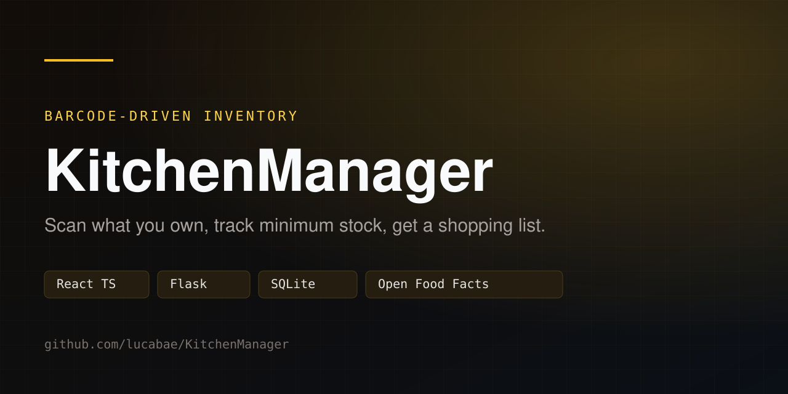
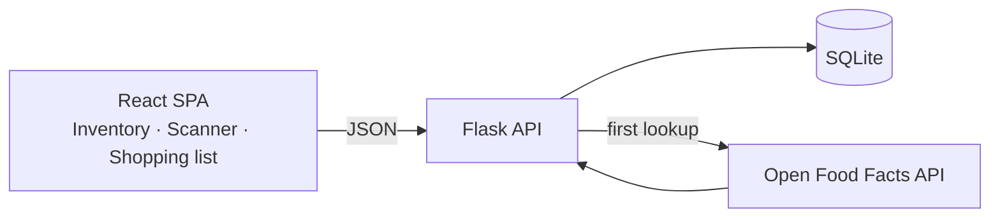
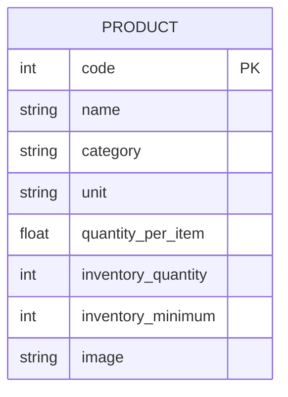

<div align="center">
  
</div>

# KitchenManager

A small web app for keeping track of what is in your kitchen. Scan a product's barcode, set how much you own and the minimum you always want, and get a shopping list that tells you what to buy and how much.

Built to solve a concrete problem: forgetting half the shopping list.

## What it does

- **Inventory**: current quantity and minimum quantity per product, with images and categories from Open Food Facts.
- **Scanner**: camera-based barcode scanning with `html5-qrcode` and Quagga2.
- **Shopping list**: every product below its minimum, with the exact difference.
- Products are fetched once from the Open Food Facts API and stored locally, so later lookups do not hit the network.

## Stack

| Layer | Technology |
|---|---|
| Frontend | React 19, TypeScript, Vite, Tailwind CSS 4, React Router |
| Backend | Flask, flask-cors, requests |
| Data | SQLite |
| External API | Open Food Facts v2 |

The frontend expects `VITE_BACKEND_URL` in `frontend/.env`.

## Architecture



## Data model



A product is identified by its EAN barcode. The shopping list is a query over `inventory_quantity < inventory_minimum`.

## API

| Method | Route | Purpose |
|---|---|---|
| `GET` | `/inventory` | All products with their stock |
| `GET` | `/shopping-list` | Products below their minimum |
| `GET` | `/product/<code>` | Fetch a product; downloads and stores it from Open Food Facts on first access |
| `POST` | `/product/<code>` | Add one unit |
| `DELETE` | `/product/<code>` | Remove one unit, never below zero |
| `PUT` | `/product/<code>` | Set the minimum quantity |

## Run it

Requirements: Python 3.10+, Node.js 20+, npm.

Backend:

```bash
cd backend
python3 -m venv venv
venv/bin/pip install -r requirements.txt
venv/bin/python setupDB.py     # creates the SQLite database
venv/bin/flask --app main run --port 5000
```

Frontend:

```bash
cd frontend
npm install
cp .env.example .env    # VITE_BACKEND_URL, default http://localhost:5000
npm run dev
```

Open the Vite URL. The frontend reads the backend address from `VITE_BACKEND_URL`.

## Structure

```
backend/
  main.py          Flask routes
  functions/       One module per query or mutation
  serializer/      Row-to-dict conversion
  setupdb.sql      Schema
frontend/
  src/pages/       Inventory, Scanner, ShoppingList
  src/components/  Product, InventoryModify, InventoryMinimum
```

## Notes

- SQLite allows a single writer at a time, so connections are opened and closed per operation to avoid `database is locked` errors.
- The scanner needs camera permission and a secure context (`localhost` or HTTPS).
- Product data comes from Open Food Facts; missing or incomplete entries are shown as returned by the API.

## License

MIT. See [LICENSE](LICENSE).
